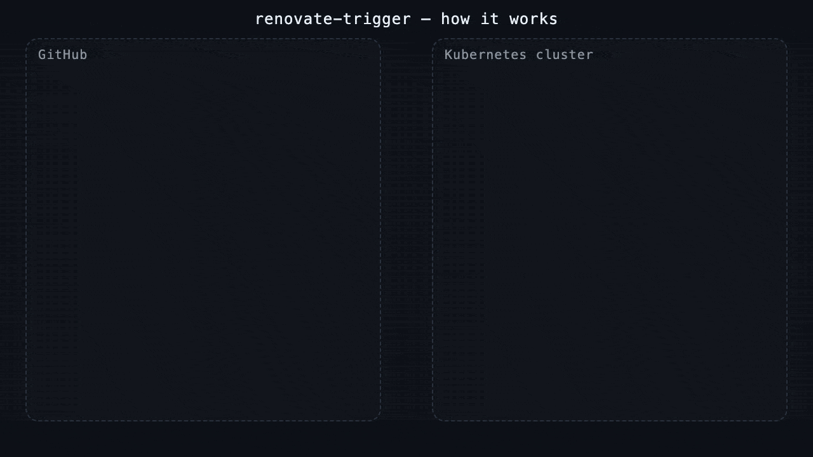

# renovate-trigger

Reacts to publication events and runs Renovate on the repositories that
**consume** what was published. When a **dependency** publishes — a GitHub repo
tags a commit, or an ECR repository receives an image push — the service reads
that dependency's trigger declaration to find its **dependents**, batches them
over a short window, and creates a one-off Kubernetes `Job` cloned from an
existing Renovate `CronJob` — injecting the dependents via `RENOVATE_REPOSITORIES`.

A single **GitHub App** both delivers the webhooks and grants read access to the
trigger files. AWS ECR image pushes are an optional second source, delivered by an
EventBridge rule to an SQS queue the pod long-polls.

- Domain vocabulary → [`CONTEXT.md`](./CONTEXT.md)
- Requirements & config reference → [`REQUIREMENTS.md`](./REQUIREMENTS.md)
- Diagrams → [`WORKFLOWS.md`](./WORKFLOWS.md)
- Design decisions → [`docs/adr/`](./docs/adr/)

## How it works

A new tag on a dependency repo flows through renovate-trigger — batched over a
tumbling window, gated so runs never overlap, and resolved via
`renovate.trigger.json` — into a one-off Renovate Job that opens a PR in the
consuming Argo CD (dependent) repo.



Full step-by-step diagrams are in [`WORKFLOWS.md`](./WORKFLOWS.md); the animation
source lives in [`docs/animation/`](./docs/animation/).

## Opting a repository in

A dependency declares its own dependents, next to the thing being published. There
is no central mapping to maintain.

**GitHub** — add `renovate.trigger.json` to the **default branch** of a repository
whose tags should trigger Renovate on its consumers:

```json
{ "tags": ["org/dependent-a", "org/dependent-b"] }
```

A tag on a repo with no such file (or without the App installed) is ignored.

**ECR** — tag the repository with `renovate-trigger/dependents`, comma-separated:

```sh
aws ecr tag-resource \
  --resource-arn arn:aws:ecr:eu-west-1:123456789012:repository/api \
  --tags Key=renovate-trigger/dependents,Value=org/dependent-a,org/dependent-b
```

An image push to a repository without that tag is ignored. AWS caps a tag value at
256 characters, so an ECR repository can declare roughly a dozen dependents.

## Installation

### Prerequisites

- A **Renovate `CronJob`** already deployed in the cluster — its `jobTemplate`
  is what this service clones for each run.
- Cluster access (`kubectl`/`helm`) to the CronJob's namespace.
- A way to expose the service's `/webhook` endpoint to GitHub (an Ingress).
- An **existing Kubernetes Secret** with the App credentials — the chart does
  **not** create one; provision it out of band (e.g. with External Secrets
  Operator, or by rendering the Secret / an `ExternalSecret` through the chart's
  `extraObjects:` value). A single Secret with three keys: the App **client ID**,
  the App **private key** (PEM), and the **webhook secret**.

### 1. Create a GitHub App

In **Settings → Developer settings → GitHub Apps → New GitHub App** (org- or
user-owned):

- **Permissions → Repository → Contents: `Read-only`.** This is used both to read
  each repo's `renovate.trigger.json` *and* to unlock the `Create` event below —
  `Create` only becomes selectable once Contents is granted.
- **Subscribe to events → check `Create`.** This is GitHub's event for tag (and
  branch) creation; the service ignores branches and acts only on tags. There is
  **one** App-level webhook — you never configure per-repo webhooks. Note the
  three-tag delivery limit in [Limitations](#limitations).
- **Webhook:** set **Active**, **URL** = `https://<your-host>/webhook`, and a
  strong random **Secret**.
- **Generate a private key** and download the `.pem`.
- Note the App's **Client ID**.

Store these three — **client ID**, **private key** (PEM), and **webhook secret**
— in the existing credentials Secret (see step 3).

### 2. Install the App on your repositories

Install the App on the **dependency** repos whose tags should trigger Renovate.
Only installed repos deliver events and are readable — App-installed + a
`renovate.trigger.json` present is the opt-in.

### 3. Configure and deploy

Put your settings in a values file — `renovate-trigger.values.yaml`. Install into
the **same namespace as the Renovate CronJob**; the service is co-located with
it, so the CronJob namespace is just the release namespace.

```yaml
config:
  cronjob:
    name: renovate            # source Renovate CronJob (its jobTemplate is cloned)
    # namespace: ...          # only if it differs from the release namespace

# Existing Secret holding the App credentials (created out of band, e.g. via
# External Secrets Operator) — one Secret, three keys. Override the key names to
# match yours.
existingSecret:
  name: renovate-trigger
  clientIdKey: github-client-id
  privateKeyKey: github-app-private-key
  webhookSecretKey: webhook-secret

# Expose /webhook at the host used for the App's webhook URL (step 1).
# Enable ONE of the following, or wire your own routing instead.
ingress:
  enabled: true
  host: renovate-trigger.example.com
  className: nginx
  tls:
    enabled: true

# Traefik alternative (leave `ingress` disabled if you use this):
# ingressRoute:
#   enabled: true
#   host: renovate-trigger.example.com
#   entryPoint: websecure
#   labels:
#     nobi.life/traefik-scope: external
```

Then install — the chart and image are published to GHCR:

<!-- x-release-please-start-version -->
```sh
helm install renovate-trigger oci://ghcr.io/caseycs/charts/renovate-trigger \
  --version 0.3.1 --namespace renovate \
  -f renovate-trigger.values.yaml
```
<!-- x-release-please-end -->

To install from a local checkout instead, swap the chart reference for `./chart`.

The service starts only if the config is valid — a missing key in the Secret or
an unreachable CronJob crash-loops the pod at boot (fail-loud by design).

### 4. Opt repositories in

For each dependency repo, add a `renovate.trigger.json` on its default branch —
see [Opting a repository in](#opting-a-repository-in) above.

## AWS: ECR image pushes as a second event source

Optional and off by default. An EventBridge rule on the default bus writes
successful `ECR Image Action` / `PUSH` events to an SQS queue that the pod
long-polls; at flush time the pod reads each pushed repository's
`renovate-trigger/dependents` tag. There is no extra ingress and no second
webhook secret.

### Prerequisites

- An **EKS** cluster with the **`eks-pod-identity-agent`** addon installed. The
  Terraform module can create it (`manage_pod_identity_agent = true`), but a
  cluster-wide addon is usually owned by whatever provisions the cluster.
- Credentials come from the Pod Identity association only. The chart sets
  `AWS_EC2_METADATA_DISABLED=true` when ECR is enabled, so a misconfigured
  association crash-loops the pod instead of silently using the node role.

### 1. Apply the Terraform

<!-- x-release-please-start-version -->
```hcl
module "renovate_trigger_ecr" {
  source = "git::https://github.com/caseycs/renovate-trigger.git//terraform?ref=v0.3.1"

  cluster_name         = "platform-eu-west-1"
  namespace            = "renovate"        # the Helm release namespace
  service_account_name = "renovate-trigger" # must match the SA the chart renders

  create_alarms        = true
  alarm_sns_topic_arns = ["arn:aws:sns:eu-west-1:123456789012:platform-alerts"]
}
```
<!-- x-release-please-end -->

It creates the rule, the delivery queue and its dead-letter queue, a
customer-managed KMS key, the IAM role, and the Pod Identity association. The key
is not optional: EventBridge cannot deliver to a queue encrypted with an AWS owned
key, so SQS-managed SSE is unavailable. Cost is roughly a dollar a month, nearly
all of it the key.

The association binds the role to one namespace and one ServiceAccount name, so
renaming the release or overriding `serviceAccount.name` means re-applying it.

State and backend are yours: `terraform/` is a module, not a root configuration.

### 2. Point the chart at the queue

```sh
terraform output -raw helm_values > renovate-trigger.aws.values.yaml
helm upgrade renovate-trigger oci://ghcr.io/caseycs/charts/renovate-trigger \
  --namespace renovate \
  -f renovate-trigger.values.yaml \
  -f renovate-trigger.aws.values.yaml
```

Or set the values directly:

```yaml
config:
  ecr:
    enabled: true
    queueUrl: "https://sqs.eu-west-1.amazonaws.com/123456789012/renovate-trigger-ecr-image-push"
    region: "eu-west-1"
```

`region` is required when enabled — Pod Identity injects credentials but no region.

### 3. Tag the ECR repositories

See [Opting a repository in](#opting-a-repository-in) above. Every image push in
the account reaches the queue by default and repositories without the tag are
dropped after one cheap tag read; narrow the rule with
`dependency_repository_name_prefixes` only if a high-volume CI repository is noisy.

> **Note on who can opt in.** On GitHub, opting a dependency in needs write access
> to its default branch. On ECR it needs `ecr:TagResource`, which many CI roles
> already hold — so anyone with it can nominate arbitrary GitHub repositories as
> dependents and have Renovate open PRs against them. Consider an SCP denying
> `ecr:TagResource` on the `renovate-trigger/dependents` tag key to all but a
> platform role.

## Limitations

### More than three tags pushed at once

GitHub does not deliver tag webhooks when a single push creates **four or more**
tags:

> This event will not occur when more than three tags are created at once.
> — [`create` event](https://docs.github.com/en/webhooks/webhook-events-and-payloads#create)

The same threshold applies to the `push` event — *"Events will not be created for
tags when more than three tags are pushed at once"* — so there is no alternative
event to fall back on. Nothing arrives: the delivery does not even appear in the
App's webhook deliveries UI, and the service never learns those tags exist.

In practice this affects a `git push --tags` that creates several tags at once, a
tag backfill, or monorepo release tooling that tags four or more packages in one
run. **Three or fewer tags in one push is fine** — GitHub sends one `create` per
tag and the batch collector dedupes them into a single Renovate run.

There is no server-side workaround; the limit is enforced before delivery. When
it happens the scheduled Renovate `CronJob` is the backstop — triggers are lossy
by design and never retried (see
[NFR-4](./REQUIREMENTS.md#nfr-4-reliability)) — so dependents pick up the new
version on the next scheduled run rather than within the batch window. To keep
the fast path, have dependency repos push tags in batches of three or fewer.

## Configuration

All operational config is via `RT_*` environment variables (set by the chart);
the dependency graph itself lives in per-repo trigger declarations — a
`renovate.trigger.json` file on GitHub, a `renovate-trigger/dependents` resource
tag on ECR. See the
[configuration reference](./REQUIREMENTS.md#configuration-reference).

