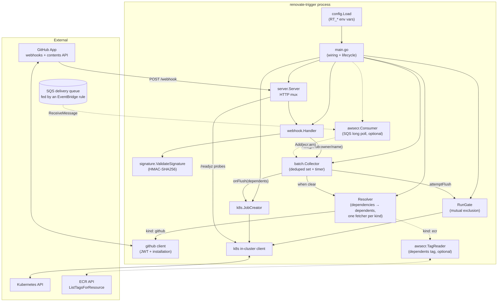
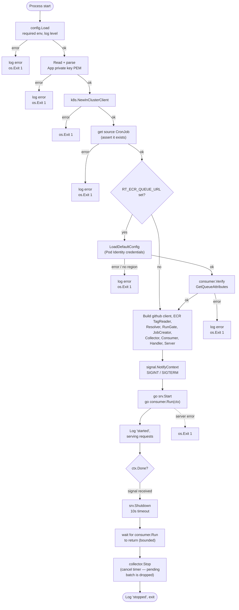
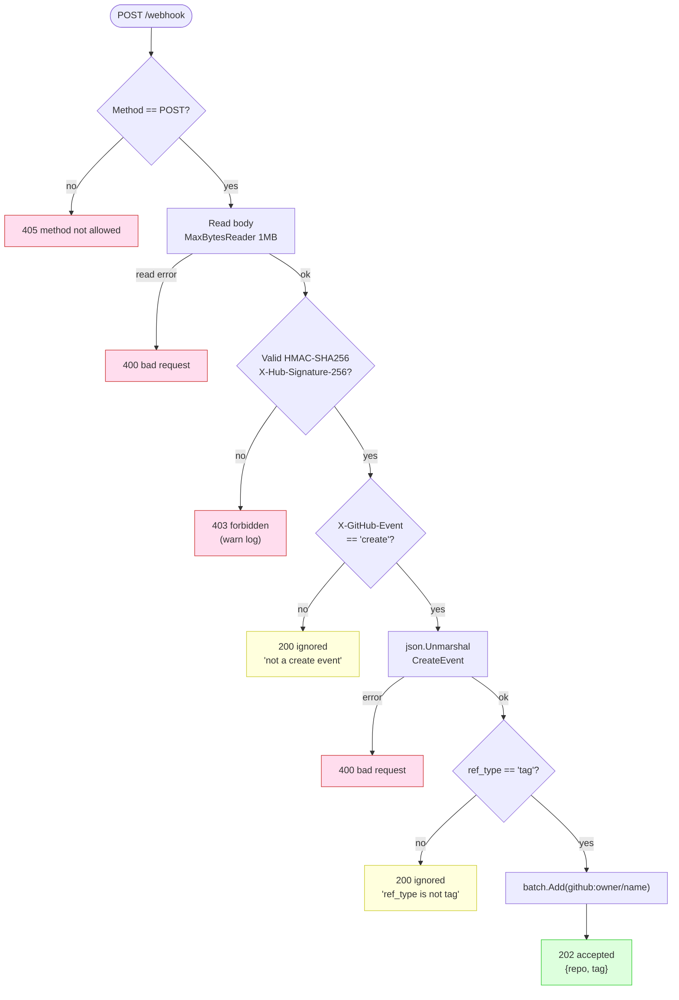
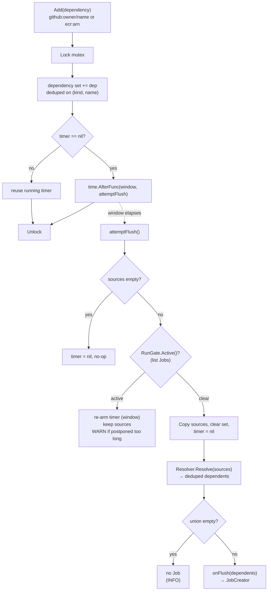
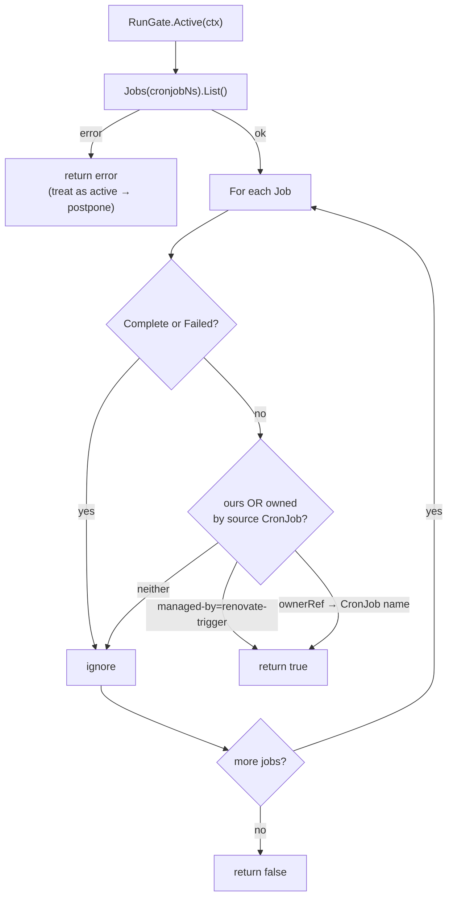
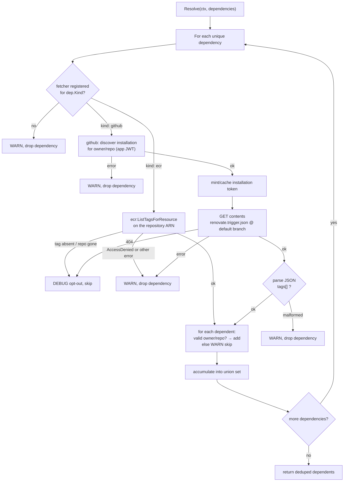
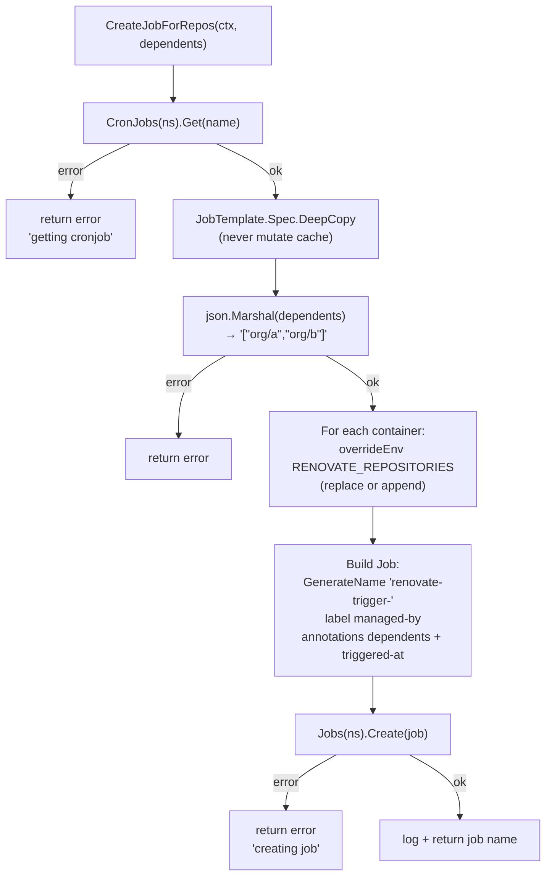
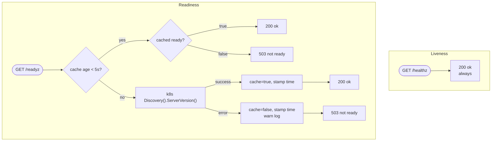
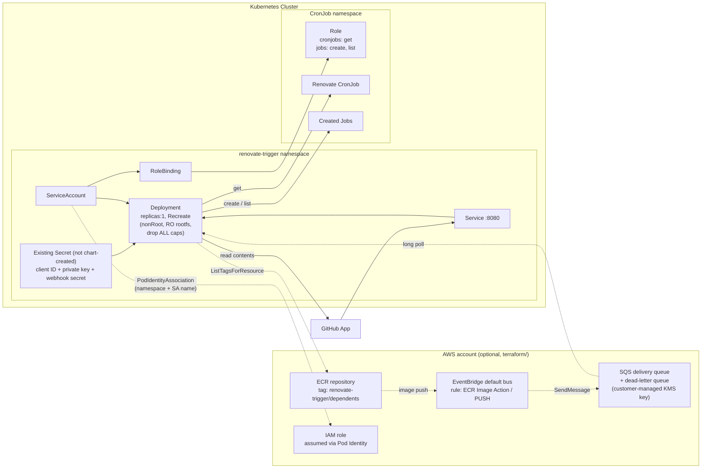
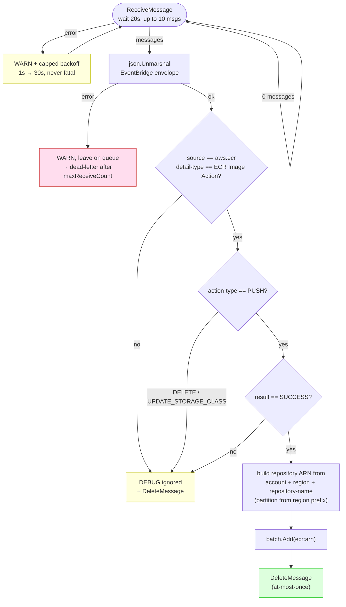

# Renovate-Trigger — Workflow Diagrams

`renovate-trigger` reacts to publication events and runs Renovate on the repos
that **consume** what was published. A git tag on a **dependency** repo — or an
image push to a dependency ECR repository — is batched over a short window; at
flush it reads each dependency's trigger declaration to resolve its
**dependents**, then — if no Renovate run is already active — creates a one-off
`Job` cloned from an existing Renovate `CronJob`, injecting the dependents via
`RENOVATE_REPOSITORIES`.

A single **GitHub App** both delivers the webhooks and grants read access to the
trigger files. The optional **ECR** source is an EventBridge rule writing image
pushes to an SQS queue the pod long-polls, with dependents declared in a
`renovate-trigger/dependents` resource tag. See `CONTEXT.md` for vocabulary and
`docs/adr/` for the decisions.

> Diagrams reflect the intended design: decentralized opt-in via
> `renovate.trigger.json`, GitHub-App auth (client-ID JWT, per-repo installation
> discovery), flush-time resolution, and best-effort mutual exclusion.

---

## 1. Component Architecture

How the packages wire together, from `main.go` down to the external APIs.

The dashed edges are the optional ECR event source: absent unless
`RT_ECR_QUEUE_URL` is set, in which case no AWS client is constructed at all and
the Resolver has no fetcher registered for the `ecr` kind.

---

## 2. Startup & Graceful Shutdown

Lifecycle managed in `cmd/renovate-trigger/main.go`. Startup fails loud on any
config error; it does **not** mint a GitHub token at boot.

---

## 3. GitHub Webhook Request Handling

`internal/webhook/handler.go` — validation and event-filtering gauntlet. No
GitHub calls happen here; an accepted event just adds the **dependency** to the
batch. Opt-out (no trigger file) is discovered later, at flush.

> The opt-in gate (App installed + trigger file present) is not enforced here —
> a dependency with no `renovate.trigger.json` is accepted, then contributes
> nothing at resolution time (logged DEBUG).

---

## 4. Batch Collection, Gate & Flush

`internal/batch/collector.go` — a fixed tumbling window over **dependencies**,
deduplicated on the `(kind, name)` pair so one multi-architecture image push
collapses to a single entry. On fire, the flush is gated by mutual exclusion; if a
Renovate run is active it postpones and keeps accumulating.

---

## 5. Mutual Exclusion (RunGate)

Whether a Renovate run is already active. Best-effort — the CronJob is not
suspended, so a small TOCTOU window against the CronJob controller is accepted.

---

## 6. Resolution (Resolver + per-kind fetchers)

`Resolver` expands the batch of dependencies into the deduped union of their
dependents, dispatching to one fetcher per dependency kind. Per-dependency
failures degrade independently (one broken declaration never sinks the batch).

---

## 7. Kubernetes Job Creation

`internal/k8s/job.go` — clone the CronJob's `JobTemplate`, inject the resolved
dependents, create.

---

## 8. Health & Readiness Probes

`internal/server/server.go` — liveness always OK; readiness checks only the K8s
API (5s cache). Readiness does **not** depend on GitHub or on the CronJob.

---

## 9. Deployment Topology (Helm)

`chart/` — single replica, least-privilege RBAC scoped to the CronJob namespace.
GitHub App credentials come from a single existing Secret (not created by the
chart; e.g. provisioned by External Secrets Operator). The AWS half is optional
and provisioned by the Terraform module in `terraform/`.

> The association binds the role to one namespace and one ServiceAccount name, so
> renaming the release — or overriding `serviceAccount.name` — means re-applying
> the Terraform. `strategy: Recreate` means a `helm upgrade` always gets a fresh
> pod, so credential changes take effect without extra steps.

---

## 10. ECR Image-Push Ingestion

`internal/awsecr/consumer.go` — the SQS counterpart of §3. Validation is a filter
gauntlet rather than a signature check: the queue is only writable by the one
EventBridge rule, so authenticity is enforced by the queue policy, not by the app.

> `image-tag` is deliberately not checked: it is absent for untagged (digest-only)
> pushes, and a multi-architecture push emits several events naming one repository
> that the batch collapses into one entry.
>
> An unparseable body is the one case that is *not* deleted — it will never become
> parseable, so letting the redrive policy move it to the dead-letter queue makes
> it visible instead of hiding it.
